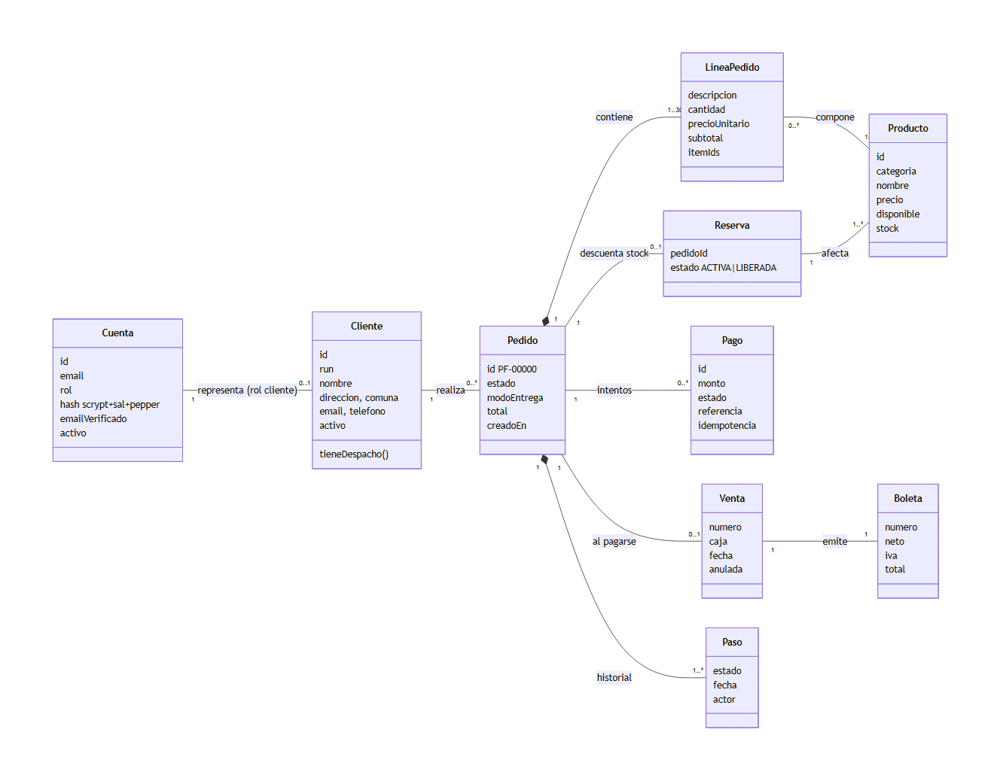
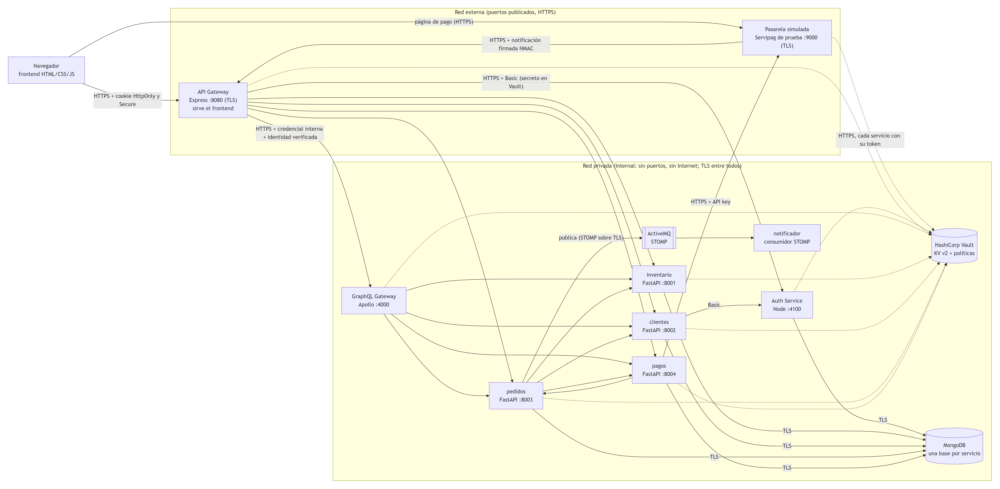
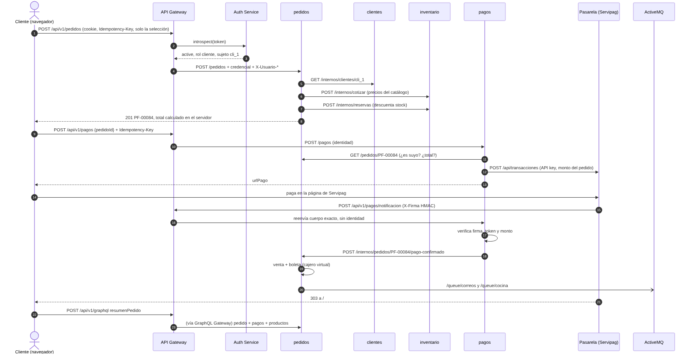
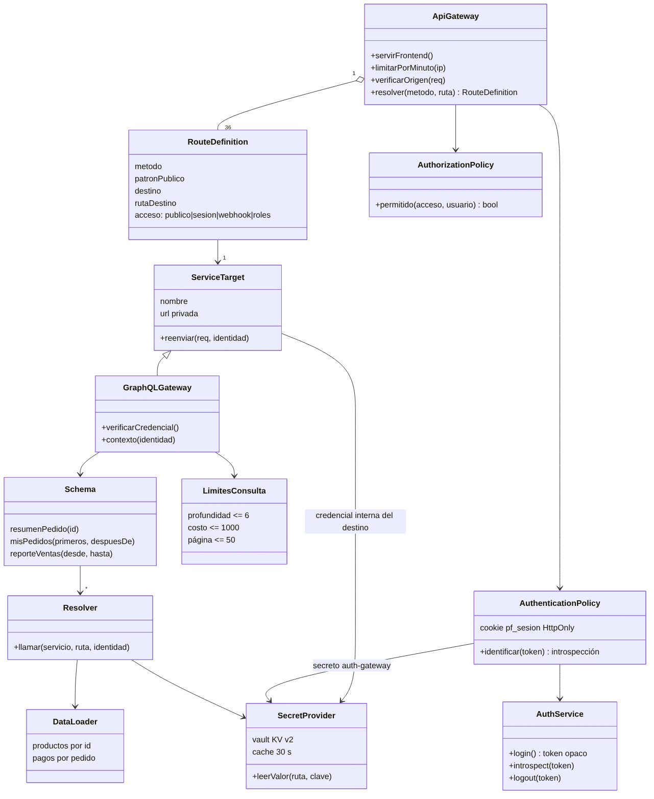
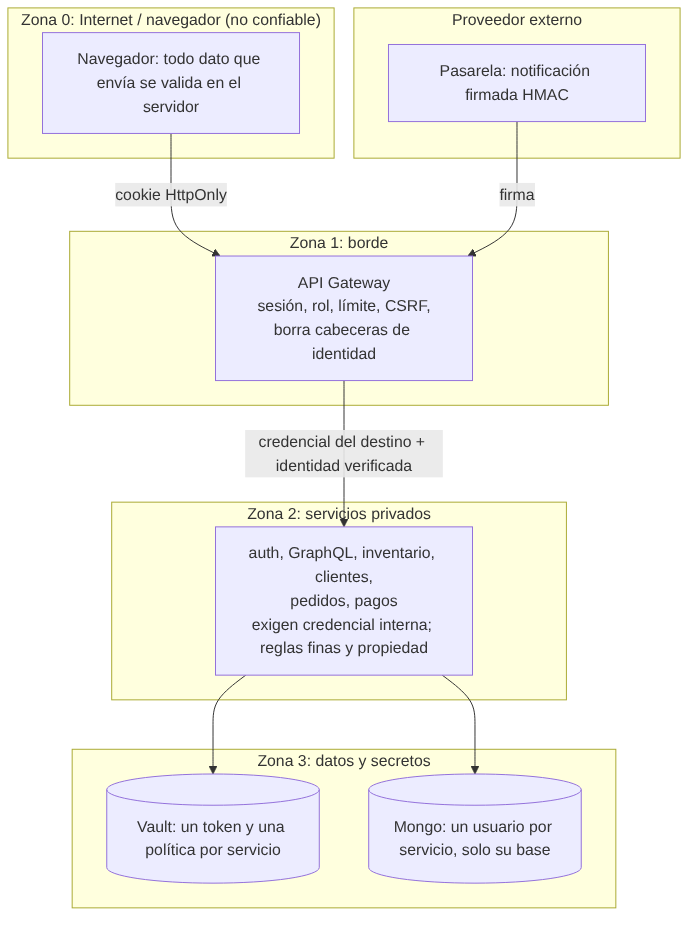
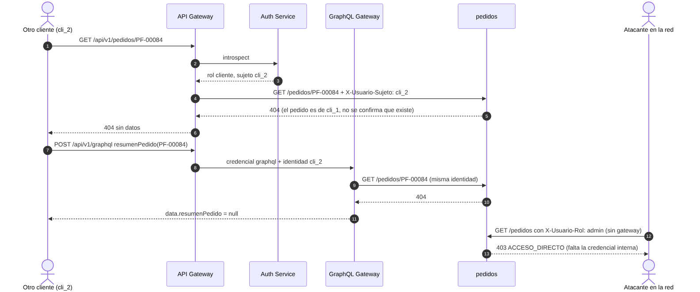

# Evaluación Unidad 2: backend seguro completo

| | |
|---|---|
| **Caso** | 24, Poke Fresh: venta web de poke bowls con retiro en local y despacho gratis a 3 km |
| **Ramo** | Desarrollo Web, Ingeniería Civil Informática, UNAB |
| **Integrantes** | Kevin Muñoz (trabajo individual) |
| **Versión del frontend** | 2.0: SPA en HTML, CSS y JavaScript sin frameworks, integrada con la API (rama `Evaluacion-2`). La versión 1.0 (entrega de frontend) guardaba todo en `localStorage`. |
| **Fecha** | 09-11-2026 |

Los diagramas están en `docs/diagramas/` como archivos Mermaid (`.mmd`, editables en cualquier editor de texto o en mermaid.live) y su imagen (`.png`). Las evidencias de ejecución están en `docs/evidencias/`. Además, [`docs/diagramas/poke-fresh.dsl`](diagramas/poke-fresh.dsl) modela el sistema en C4 con Structurizr DSL (adaptación del modelo de referencia del curso): contexto, contenedores, componentes, 14 flujos dinámicos y 2 despliegues.

## Índice

0. [Requisitos y brechas declaradas](#0-requisitos-y-brechas-declaradas)
1. [Servicios y contratos](#1-servicios-y-contratos)
2. [Dominio y límites de los microservicios](#2-dominio-y-límites-de-los-microservicios)
3. [Sistemas, componentes e integración](#3-sistemas-componentes-e-integración)
4. [Stakeholders y matriz de permisos](#4-stakeholders-y-matriz-de-permisos)
5. [API Gateway, políticas y fronteras de confianza](#5-api-gateway-políticas-y-fronteras-de-confianza)
6. [Rutas, secretos, identidades y operaciones GraphQL](#6-rutas-secretos-identidades-y-operaciones-graphql)
7. [Datos sensibles y secretos del cliente](#7-datos-sensibles-y-secretos-del-cliente)
8. [Separación privada y agregaciones GraphQL](#8-separación-privada-y-agregaciones-graphql)
9. [Analítica y gRPC](#9-analítica-y-grpc)
10. [Backend completo e integración verificable](#10-backend-completo-e-integración-verificable)

---

## 0. Requisitos y brechas declaradas

### Requisitos del caso

| Id | Requisito |
|---|---|
| R1 | Catálogo por categorías (bases, proteínas, salsas, toppings, bebidas, promociones), con dos tamaños y reglas de armado (bases y proteínas incluidas, recargos por extra e ingredientes premium) |
| R2 | Armar un bowl personalizado y ver su precio |
| R3 | Promociones armables (combo con bebida, dúo de bowls) |
| R4 | Carrito de compra |
| R5 | Registro de clientes con RUN, nombre, dirección, región/provincia/comuna, fecha de nacimiento, sexo, correo y teléfono; verificación del correo |
| R6 | Ingreso de clientes y de usuarios internos con perfiles: administrador, dueño, cocina y encargado de despacho |
| R7 | Venta solo a clientes registrados; retiro en local o despacho gratis dentro de 3 km |
| R8 | Pago en línea en Servipag; con el pago confirmado, el cajero virtual registra la venta y emite la boleta electrónica, que se envía al correo |
| R9 | Cocina recibe los pedidos pagados en orden de llegada, con aviso, los acepta y los marca listos |
| R10 | Despacho asigna chofer y registra la entrega; los retiros quedan listos en el local |
| R11 | Anulación con motivo mientras cocina no acepte; si estaba pagado, se devuelve el pago |
| R12 | Mantenedores: productos (precio, disponibilidad, stock), clientes (incluido el registro en el local con clave temporal) y usuarios internos |
| R13 | Caja web del día y reporte de ventas por período, descargable en CSV |
| R14 | Seguimiento del pedido, boleta e historial del cliente |

### Brechas declaradas

Lo que no se implementa como en producción, por qué, y qué lo reemplaza:

| Brecha | Motivo | Cómo se cubre |
|---|---|---|
| Servipag no tiene un entorno de pruebas abierto | Proveedor externo sin sandbox público | `servicios/pasarela`: simulador con el mismo contrato que una pasarela real (API key del comercio, página de pago, notificación firmada con HMAC, reintentos, devoluciones). El servicio de pagos se integra igual que con una real |
| Correo (código de verificación, boleta) | Sin proveedor de correo | En modo demo el código vuelve en la respuesta y se muestra como "correo simulado"; la boleta se publica en ActiveMQ y el notificador registra el envío. Con `MODO_DEMO=false` no se devuelve |
| Radio de 3 km | Sin servicio de mapas | Se aproxima por comuna (Providencia, Ñuñoa, Santiago, Recoleta y Las Condes), validado en el servidor |
| Certificados de prueba y sin TLS mutuo | Entorno local: no hay una CA pública que emita certificados para `localhost` | Hay TLS en todos los saltos (navegador → gateway, gateway → servicios, servicio → servicio, Vault, Mongo y ActiveMQ) con una CA propia que crea `tls-init` en el arranque. El navegador avisa que esa CA no es de confianza. Los clientes verifican al servidor con la CA, pero no presentan certificado propio (se autentican con credencial: TLS mutuo queda para producción) y las claves privadas están en un volumen compartido de solo lectura, igual que los tokens de Vault. La red privada además sigue siendo `internal`. En producción: certificados de una CA real con renovación automática |
| Desbloqueo de Vault | Entorno de desarrollo | La clave de desbloqueo y el token raíz quedan en un volumen local para que el sistema arranque solo. En producción: auto-unseal con KMS y token raíz revocado |
| Distribución de tokens de Vault | Docker Compose no entrega un archivo distinto a cada contenedor sin un orquestador | Cada servicio tiene su propio token con su propia política, pero todos se escriben en un mismo volumen de solo lectura. En producción, el orquestador (Docker secrets o Kubernetes) monta cada token solo en su contenedor |
| Sesiones del Auth Service | Se guardan en memoria | Un reinicio del Auth Service cierra todas las sesiones (falla segura: hay que volver a ingresar) |
| ActiveMQ sin autenticación | Broker solo accesible en la red privada | Si se expone, se activa usuario y clave en el broker y se guardan en Vault |
| Aviso a cocina "en vivo" | Sin WebSocket ni SSE | La pantalla de cocina consulta cada 8 s y avisa con sonido; ActiveMQ ya publica el evento por si se quiere empujar (ver ADR 0001) |
| Casos 7.9, 7.10 y 10.7 no se ejecutan contra Docker | Prueban acceso directo a los servicios, secretos ajenos en Vault y Vault sellado, y desde el equipo la red privada no se alcanza (es lo que se busca) | Corren con `casos.py --directo` en el entorno local sin Docker (22 casos en total); en Docker la separación de redes se comprueba porque solo se publican los puertos 8080 y 9000 |
| GitHub Pages | El frontend ahora necesita la API | Se sirve desde el gateway (mismo origen que la API). La versión estática de la entrega anterior sigue en la rama `Front-end` |

---

## 1. Servicios y contratos

### Trazabilidad de pantallas

| Pantalla (ruta del frontend) | Operaciones | Servicio y endpoint (vía `/api/v1`) |
|---|---|---|
| Inicio, Menú `#/menu`, Arma tu bowl, Promo, Carrito | Ver catálogo, tamaños, reglas y promociones | inventario: `GET /catalogo/items`, `GET /catalogo/configuracion` |
| Ingresar `#/ingresar` | Login, cuentas de prueba (demo) | gateway + Auth Service: `POST /auth/login`, `GET /auth/config` |
| Registro `#/registro`, Verificar `#/verificar` | Crear cuenta, verificar correo, reenviar código | clientes: `POST /clientes/registro`; Auth: `POST /auth/verificar`, `POST /auth/reenviar` |
| Mis datos `#/mi-cuenta` | Ver y editar ficha, cambiar clave | clientes: `GET/PUT /clientes/yo`; Auth: `PUT /auth/clave` |
| Mis pedidos `#/mis-pedidos` | Historial propio | pedidos: `GET /pedidos` |
| Confirmar pedido `#/checkout` | Crear pedido (solo la selección) | pedidos (+ clientes + inventario): `POST /pedidos` |
| Pago `#/pago/:id` | Iniciar pago e ir a Servipag | pagos (+ pedidos + pasarela): `POST /pagos` |
| Pedido `#/orden/:id` | Seguimiento, pagos, anular | **GraphQL** `resumenPedido`; pedidos: `POST /pedidos/:id/anular` |
| Boleta `#/boleta/:n` | Ver e imprimir | pedidos: `GET /pedidos/boleta/:n` |
| Panel: Pedidos `#/admin/pedidos` | Filtrar, anular | pedidos: `GET /pedidos?estado&q`, `POST /pedidos/:id/anular` |
| Panel: Cocina `#/admin/cocina` | Cola, aceptar, marcar listo, orden imprimible | pedidos: `GET /pedidos?cola=cocina`, `POST /pedidos/:id/aceptar`, `/terminar`, `/impresa` |
| Panel: Despacho `#/admin/despacho` | Cola, asignar chofer, entregar | pedidos: `GET /pedidos?cola=despacho`, `POST /pedidos/:id/despachar`, `/entregar` |
| Panel: Caja `#/admin/caja` | Ventas del día | pedidos: `GET /reportes/ventas` |
| Panel: Reportes `#/admin/reportes` | Reporte, CSV, categorías, conciliación | pedidos: `GET /reportes/ventas`; **GraphQL** `reporteVentas` |
| Panel: Productos `#/admin` | CRUD, stock, disponibilidad | inventario: `GET/POST/PUT/DELETE /catalogo/items` |
| Panel: Clientes `#/admin/clientes` | Listar, registrar en local, editar, activar | clientes: `GET/POST /clientes`, `GET/PUT /clientes/:id`, `PATCH /clientes/:id/estado` |
| Panel: Usuarios `#/admin/usuarios` | Listar, crear, editar, activar | Auth: `GET/POST /usuarios`, `PUT /usuarios/:id`, `PATCH /usuarios/:id/estado` |

### Catálogo de servicios

| Servicio | Tecnología | Responsabilidad | Datos propios | Expuesto |
|---|---|---|---|---|
| API Gateway | Node, Express | Servir el frontend, sesión, autorización por rol, enrutamiento, límites, CSRF | Ninguno | Sí (8080) |
| Auth Service | Node, Express | Cuentas, contraseñas, sesiones, introspección, verificación de correo, usuarios internos | `pf_auth.cuentas` | No |
| GraphQL Gateway | Node, Apollo Server 4 | Agregaciones de lectura entre servicios | Ninguno | No |
| inventario | Python, FastAPI | Catálogo, precios, reglas, cotización, stock y reservas | `pf_inventario.items`, `reservas` | No |
| clientes | Python, FastAPI | Ficha del cliente | `pf_clientes.clientes` | No |
| pedidos | Python, FastAPI | Pedidos, estados, venta, boleta, colas, reporte | `pf_pedidos.pedidos`, `contadores` | No |
| pagos | Python, FastAPI | Pagos, idempotencia, notificaciones, devoluciones | `pf_pagos.pagos` | No |
| notificador | Python, stomp.py | Consumir `/queue/correos` y `/queue/cocina` | Ninguno | No |
| Pasarela (simulada) | Python, FastAPI | Proveedor externo de pago | Memoria | Sí (9000) |

### Ejemplos de contratos

Todos los errores tienen la misma forma: `{"codigo": "NO_ENCONTRADO", "mensaje": "No encontramos ese pedido.", "idPeticion": "..."}`.

**Crear pedido.** El navegador manda solo la selección; el precio lo calcula inventario.

```http
POST /api/v1/pedidos
Cookie: pf_sesion=<token opaco, HttpOnly>
Idempotency-Key: 2f1c0b7e-...

{"modoEntrega": "DELIVERY", "nota": "Sin sésamo",
 "lineas": [{"tipo": "BOWL", "cantidad": 1,
             "entrada": {"tamanoId": "regular", "baseIds": ["base_gohan"], "proteinaIds": ["pro_salmon"],
                         "salsaIds": ["sal_ponzu"], "toppingIds": ["top_palta"]}}]}
```

```json
201 Created
{"id": "PF-00084", "clienteId": "cli_demo_1", "estado": "PENDIENTE_PAGO", "modoEntrega": "DELIVERY",
 "direccion": "Av. Providencia 2133, depto 504, Providencia",
 "lineas": [{"tipo": "BOWL", "descripcion": "Bowl Regular: Arroz gohan, Salmón fresco, Ponzu, Palta",
             "cantidad": 1, "precioUnitario": 7890, "subtotal": 7890,
             "itemIds": ["base_gohan", "pro_salmon", "sal_ponzu", "top_palta"]}],
 "total": 7890, "pago": {"medio": "SERVIPAG", "estado": "PENDIENTE"}, "venta": null, "boleta": null,
 "historial": [{"estado": "PENDIENTE_PAGO", "fecha": "2026-11-08T03:15:01.120Z"}]}
```

Errores: `400 FUERA_DE_RADIO`, `400 SELECCION_INVALIDA`, `409 SIN_STOCK`, `401 SIN_SESION`, `403 PROHIBIDO` (no es cliente), `502/504` si inventario o clientes no responden.

**Iniciar pago.**

```http
POST /api/v1/pagos
Idempotency-Key: 9d3e...            (obligatoria)
{"pedidoId": "PF-00084"}
```
```json
201 {"id": "PAG-07A5E9CF2BEF", "pedidoId": "PF-00084", "monto": 7890, "medio": "SERVIPAG",
     "estado": "PENDIENTE", "urlPago": "https://localhost:9000/pagar/<token>"}
```

**Notificación de la pasarela** (sin sesión; la autentica su firma).

```http
POST /api/v1/pagos/notificacion
X-Firma: <hex de HMAC-SHA256(cuerpo, secreto_firma)>
{"token": "...", "orden": "PAG-07A5E9CF2BEF", "monto": 7890, "estado": "APROBADO", "referencia": "SVP-99801681"}
```
`200 {"ok": true, "repetido": false}`; repetida: `{"repetido": true}`; sin firma o firma falsa: `401 FIRMA_INVALIDA`; monto distinto: `409 MONTO_DISTINTO`.

**Cambiar estado (cocina).** `POST /api/v1/pedidos/PF-00084/aceptar` → `200` con el pedido en `EN_PREPARACION`; si otro puesto ya lo aceptó: `409 ESTADO`.

**Login.**

```http
POST /api/v1/auth/login
{"email": "cliente@correo.cl", "clave": "Cliente2026"}
```
```
200  Set-Cookie: pf_sesion=<token>; Path=/api; HttpOnly; SameSite=Lax; Max-Age=28800
{"tipo": "CLIENTE", "id": "cli_demo_1", "perfil": "CLIENTE", "nombre": "Javiera Morales Díaz",
 "email": "cliente@correo.cl", "expira": "2026-11-08T03:45:01.000Z"}
```
Errores: `401 CREDENCIALES` (mismo mensaje si el correo no existe), `403 SIN_VERIFICAR`, `403 INACTIVA`, `429 BLOQUEADO`.

El contrato completo de cada servicio Python se puede ver en su OpenAPI (`/docs` dentro de la red privada) y el del GraphQL Gateway en la sección 8.

---

## 2. Dominio y límites de los microservicios



### Cardinalidades y su regla de negocio

| Relación | Cardinalidad | Regla |
|---|---|---|
| Cuenta – Cliente | 1 a 0..1 | Toda ficha de cliente tiene exactamente una cuenta de rol cliente; las cuentas del personal no tienen ficha |
| Cliente – Pedido | 1 a 0..* | Solo clientes registrados compran (R7); un cliente puede no tener pedidos |
| Pedido – LineaPedido | 1 a 1..30 | Un pedido sin líneas no se crea; máximo 30 líneas y 20 unidades por línea (límite de abuso) |
| LineaPedido – Producto | 0..* a 1..* | Un bowl se compone de 2 o más productos (1 a 3 bases, 1 a 3 proteínas, hasta 4 salsas y 6 toppings); una bebida es 1 producto |
| Pedido – Paso (historial) | 1 a 1..* | Todo pedido nace con el paso PENDIENTE_PAGO; cada cambio de estado agrega un paso |
| Pedido – Venta | 1 a 0..1 | La venta se registra solo cuando el pago se confirma, una sola vez |
| Venta – Boleta | 1 a 1 | El cajero virtual emite una boleta por venta (R8) |
| Pedido – Pago | 1 a 0..* | Puede haber intentos rechazados; a lo sumo uno aprobado |
| Pedido – Reserva | 1 a 0..1 | La reserva de stock se crea al confirmar el pedido y se libera al anular |

### Separación de DTO

Cada servicio decide qué campos devuelve según quién pregunta, separando el documento guardado del objeto que viaja:

- **inventario:** el público recibe `id, categoria, nombre, descripcion, precio, disponible` (disponible = activo y con stock). `stock` y `activo` solo para admin y dueño.
- **pedidos:** cocina y despacho reciben del cliente solo `nombre` y `telefono`; el cliente recibe el historial sin el `actor` (quién del personal hizo cada paso); nunca salen `idempotencia` ni `consumo`.
- **pagos:** nunca salen el `token` de la pasarela ni la clave de idempotencia; `urlPago` solo mientras el pago está pendiente.
- **Auth Service:** nunca devuelve `hash` ni el código de verificación (se guarda solo su hash).
- **clientes:** la ficha no guarda contraseña; la cuenta (en Auth) no guarda RUN ni dirección.

### Por qué estos límites

| Servicio | Cohesión | Acoplamiento | Propiedad de datos | Evolución |
|---|---|---|---|---|
| inventario | Todo lo que define qué se vende y a qué precio | Lo consultan pedidos y GraphQL; no llama a nadie | Productos, stock, reservas | Cambiar recargos o agregar tamaños no toca pedidos |
| clientes | Datos personales del comprador | Llama a Auth para crear la cuenta | Fichas | Puede crecer (direcciones múltiples) sin tocar pedidos |
| pedidos | Ciclo de vida de la compra y documentos de venta | Llama a clientes, inventario y pagos | Pedidos, ventas, boletas | Nuevos estados o canales sin tocar pagos |
| pagos | Integración con el proveedor externo y dinero | Llama a pedidos y a la pasarela | Pagos | Cambiar de pasarela sin tocar pedidos |
| Auth Service | Credenciales y sesiones | Lo llaman gateway y clientes | Cuentas | Cambiar a OAuth/OIDC sin tocar los servicios |

Cada servicio modifica solo su base. Las colaboraciones usan contratos explícitos (sección 6).

---

## 3. Sistemas, componentes e integración

### Matriz de sistemas

| Sistema | Tipo | Protocolo | Lo usa | Datos que intercambia | Si falla |
|---|---|---|---|---|---|
| MongoDB 7 | Persistencia | Mongo wire sobre TLS, usuario por servicio | Auth, inventario, clientes, pedidos, pagos | Documentos de cada servicio | El servicio responde 500; `/salud` lo informa |
| HashiCorp Vault 1.18 | Secretos | HTTPS (KV v2) con token por servicio | Todos los servicios | Credenciales, pepper, claves | Se usa lo leído hasta 5 min; después 503 (no se deja pasar a nadie) |
| ActiveMQ Classic 6 | Mensajería | STOMP 1.2 sobre TLS | pedidos (publica), notificador (consume) | Boleta para correo, aviso a cocina | El pago se registra igual; queda en el log |
| Pasarela (Servipag) | Externo | HTTPS + API key; notificación con HMAC | pagos | Transacción, resultado, devolución | Pagar responde 502; la pasarela reintenta la notificación 3 veces |

### Mapa de componentes y despliegue



Modelo C4 (`docs/diagramas/poke-fresh.dsl`): 25 vistas, validadas con el comando `validate` de Structurizr (imagen `structurizr/structurizr`) y exportables a Mermaid. Incluye C1 (contexto con la pasarela externa), C2 (contenedores, con recortes de catálogo, pedidos y pagos, y secretos), C3 de API Gateway, GraphQL Gateway, Auth Service y pedidos, vistas dinámicas de los flujos de los casos de validación (catálogo y su recuperación, pedido y su reintento, pedido propio y ajeno, sesión expirada, GraphQL con éxito, con error parcial y sobre el límite, pago, confirmación firmada y notificación falsa) y dos despliegues: `Docker_Compose` (el entregado) y `Local_Sin_Docker` (pruebas, con Mongo, Vault y ActiveMQ en memoria). Para verlo: pegar el archivo en https://structurizr.com/dsl o usar el CLI. No hay imágenes renderizadas de estas vistas en el repositorio; los `.png` de arriba siguen siendo los diagramas de referencia del informe.

Despliegue (`docker-compose.yml`): 15 contenedores en dos redes (`tls-init`, `vault-init` y `semilla` son de un solo uso). `privada` es `internal: true` (sin puertos al equipo ni salida a Internet). Solo el gateway (8080) y la pasarela simulada (9000) publican puertos.

### Secuencia de integración: compra completa



### Idempotencia del pago

- **Crear pedido:** `Idempotency-Key` opcional; el frontend genera una por visita a la pantalla de confirmación. Un doble clic devuelve el mismo pedido (índice único `idempotencia`).
- **Iniciar pago:** `Idempotency-Key` obligatoria; misma clave → mismo pago. Si ya hay un pago pendiente para el pedido, se reutiliza.
- **Notificación:** se aplica con una condición atómica (`estado: PENDIENTE` en el mismo `update`). Una repetida responde `repetido: true` sin volver a registrar la venta. Si pedidos no respondió la primera vez, la repetida reintenta solo ese aviso.
- **Confirmación en pedidos:** si llega dos veces el mismo `pagoId`, la segunda no hace nada; el monto debe ser exactamente el total.
- **Reservas de stock:** una por pedido; liberar dos veces devuelve el stock una sola vez.

Probado en `servicios/tests/test_pedidos_y_pagos.py` y en los casos 10.2 y 10.3 de punta a punta.

---

## 4. Stakeholders y matriz de permisos

### Stakeholders

| Stakeholder | Interés | Qué puede hacer | Qué protege el sistema de él |
|---|---|---|---|
| Visitante | Ver el menú y precios | Catálogo, registrarse | Datos de clientes y pedidos |
| Cliente | Comprar, seguir su pedido | Sus pedidos, su ficha, pagar, anular antes de cocina | Pedidos y datos de otros clientes; fijar precios o confirmar pagos |
| Administrador | Operar todo el local | Todo el panel | Desactivarse a sí mismo o dejar el local sin administrador |
| Dueño | Ventas y productos | Reportes, caja, productos (sin eliminar) | Datos de clientes y gestión de usuarios |
| Cocina | Preparar en orden | Cola de cocina, aceptar, terminar | Reportes, RUN y correo de los clientes |
| Encargado de despacho | Entregar | Cola de despacho, chofer, entrega | Reportes, RUN y correo |
| Servipag | Cobrar | Notificar resultados firmados | Notificar sin la firma, o con otro monto |
| Equipo de TI | Operar y auditar | Logs con X-Request-Id, `/api/salud` | Ver contraseñas, tokens o cuerpos en los logs |

### Matriz de permisos por ruta, verbo y condición

La columna "Gateway" es el control grueso (rol); "Condición en el servicio" es la regla fina que aplica el dueño del dato.

| Verbo | Ruta (`/api/v1`) | Gateway | Condición en el servicio |
|---|---|---|---|
| GET | `/catalogo/items[/:id]`, `/catalogo/configuracion` | Público | Stock solo si admin o dueño |
| POST, PUT | `/catalogo/items[/:id]` | admin, dueño | Validación de nombre, precio, stock; nombre único |
| DELETE | `/catalogo/items/:id` | admin | Solo admin (también en inventario) |
| POST | `/clientes/registro` | Público (20/min por IP) | RUN válido y único, correo único, clave fuerte |
| GET, PUT | `/clientes/yo` | cliente | Solo su ficha (`X-Usuario-Sujeto`); no cambia RUN ni estado |
| GET, POST | `/clientes` | admin | — |
| GET, PUT, PATCH | `/clientes/:id[/estado]` | admin | Desactivar cierra sus sesiones |
| POST | `/pedidos` | cliente | Cuenta activa; despacho solo en radio; precio de inventario; stock |
| GET | `/pedidos` | todos los roles | Cliente: solo los suyos. Cocina: solo su cola. Despacho: solo la suya |
| GET | `/pedidos/:id` | todos los roles | Cliente: solo si es suyo (si no, 404). Cocina: solo pagados. Despacho: solo listos/en camino/entregados |
| GET | `/pedidos/boleta/:n` | cliente, admin, dueño | Cliente: solo la suya |
| POST | `/pedidos/:id/aceptar`, `/terminar` | admin, cocina | Desde PAGADO / EN_PREPARACION, condición atómica |
| POST | `/pedidos/:id/despachar`, `/entregar` | admin, despacho | Chofer válido; estado correcto |
| POST | `/pedidos/:id/anular` | cliente, admin | Cliente: solo el suyo. Solo en PENDIENTE_PAGO o PAGADO; motivo obligatorio |
| GET | `/reportes/ventas` | admin, dueño | Período máximo de un año |
| POST | `/pagos` | cliente | Idempotency-Key; pedido suyo y pendiente (lo decide pedidos); monto del pedido |
| GET | `/pagos?pedidoId` | cliente, admin, dueño | Pedidos decide si puede ver ese pedido |
| POST | `/pagos/notificacion` | Sin sesión | Firma HMAC válida, token y monto coinciden |
| POST | `/graphql` | Con sesión | Autorización por campo y por recurso (sección 8) |
| POST | `/auth/verificar`, `/auth/reenviar` | Público (20/min por IP) | No revela si el correo existe |
| PUT | `/auth/clave` | Con sesión | La cuenta sale de la sesión, no del cuerpo |
| GET, POST, PUT, PATCH | `/usuarios[...]` | admin | Siempre queda un admin activo; nadie cambia su propio perfil |

Ocultar un botón en el frontend no da ni quita permisos: todas estas reglas se prueban contra el backend (sección 7).

---

## 5. API Gateway, políticas y fronteras de confianza

### UML del gateway y sus políticas



- **RouteDefinition** (`gateway/src/rutas.js`): 36 filas; lo que no está, responde 404. Las rutas `/internos/*` de los servicios nunca se publican.
- **AuthenticationPolicy** (`sesion.js`): cookie `pf_sesion` HttpOnly; introspección en el Auth Service en cada petición.
- **AuthorizationPolicy** (`rutas.js: permitido`): público, sesión, webhook o lista de roles.
- **ServiceTarget** (`reenvio.js`): arma cabeceras nuevas, agrega la credencial del destino y la identidad, reenvía el cuerpo exacto; 502 si no responde, 504 si tarda más de 8 s.
- **SecretProvider** (`vault.js`): lee de Vault con el token del gateway, guarda 30 s.
- **GraphQLGateway, Schema, Resolver, DataLoader, LimitesConsulta**: en `graphql-gateway/` (sección 8).
- No hay clientes gRPC (ADR 0001).

### Fronteras de confianza



| Frontera | Qué se verifica al cruzarla |
|---|---|
| Navegador → gateway | TLS (HTTPS con HSTS), sesión (cookie + introspección), rol, origen (CSRF), límite por IP, tamaño del cuerpo (100 KB). Se descartan `X-Usuario-*`, `X-Credencial-Interna`, `Authorization` y la cookie antes de reenviar |
| Pasarela → gateway → pagos | Firma HMAC del cuerpo exacto, token y monto |
| Gateway → servicio | Credencial interna del servicio de destino (cada servicio tiene la suya) |
| Servicio → servicio | Credencial del destino + identidad del usuario original (el destino aplica sus reglas) |
| Servicio → Vault | Token propio con política de solo lectura en sus rutas |
| Servicio → Mongo | Usuario propio con `readWrite` solo en su base, sobre TLS |
| Todos los saltos | TLS 1.2 o superior: el cliente verifica el certificado del servidor con la CA de prueba (en Node, `NODE_EXTRA_CA_CERTS`; en Python, `SSL_CERT_FILE`; en Mongo, `tlsCAFile`). Un intento en claro contra un servicio interno se rechaza (caso 7.12 y comprobación manual) |

### Decisiones de separación

- El frontend se sirve desde el gateway: misma origen que la API, la cookie viaja sin CORS y puede ser `SameSite`.
- El gateway no tiene reglas de negocio: solo el control grueso. La propiedad del recurso la decide el servicio dueño (así no se puede saltar llamando por GraphQL).
- El GraphQL Gateway está detrás del API Gateway, no al lado: hereda sesión, límites y CSRF.
- Pagos es el único servicio privado en la red `externa`, porque es el único que habla con el proveedor.

### Recorrido de una petición autorizada y una denegada



**Autorizada:** la cocina acepta el pedido PF-00084. Navegador → `POST /api/v1/pedidos/PF-00084/aceptar` con su cookie → el gateway introspecciona (rol `cocina`) → la matriz permite `admin, cocina` → lee de Vault la credencial de pedidos → reenvía con `X-Usuario-Rol: cocina` → pedidos verifica la credencial, que el rol sea cocina o admin, que el pedido esté PAGADO (en el mismo `update`) y registra el paso con el nombre de quien lo hizo → `200`. Evidencia: caso 10.4.

**Denegada:** otro cliente pide el mismo pedido. El gateway lo deja pasar (los clientes pueden ver pedidos), pero pedidos compara `X-Usuario-Sujeto` con el dueño y responde 404, sin confirmar que existe. Por GraphQL ocurre lo mismo, porque el GraphQL Gateway reenvía la identidad. Si alguien en la red privada llama directo a pedidos con `X-Usuario-Rol: admin`, recibe 403 por no tener la credencial interna. Evidencia: casos 7.5 y 7.9.

---

## 6. Rutas, secretos, identidades y operaciones GraphQL

### Matriz de rutas

| Ruta pública (`/api/v1`) | Servicio | Ruta interna | Acceso | Controles |
|---|---|---|---|---|
| `GET /catalogo/items`, `/catalogo/items/:id`, `/catalogo/configuracion` | inventario | `/items`, `/items/:id`, `/configuracion` | público | Límite general |
| `POST /catalogo/items`, `PUT /catalogo/items/:id` | inventario | `/items[/:id]` | admin, dueño | CSRF, validación |
| `DELETE /catalogo/items/:id` | inventario | `/items/:id` | admin | CSRF |
| `POST /clientes/registro` | clientes | `/clientes/registro` | público | 20/min por IP |
| `GET, PUT /clientes/yo` | clientes | `/clientes/yo` | cliente | Propiedad |
| `GET, POST /clientes`; `GET, PUT /clientes/:id`; `PATCH /clientes/:id/estado` | clientes | igual | admin | — |
| `POST /pedidos` | pedidos | `/pedidos` | cliente | Idempotency-Key |
| `GET /pedidos`, `GET /pedidos/:id` | pedidos | igual | todos los roles | Propiedad y filtro por rol |
| `GET /pedidos/configuracion` | pedidos | `/pedidos-config` | todos los roles | — |
| `GET /pedidos/boleta/:numero` | pedidos | igual | cliente, admin, dueño | Propiedad |
| `POST /pedidos/:id/aceptar`, `/terminar` | pedidos | igual | admin, cocina | Estado atómico |
| `POST /pedidos/:id/despachar`, `/entregar` | pedidos | igual | admin, despacho | Estado atómico |
| `POST /pedidos/:id/impresa` | pedidos | igual | admin, cocina, despacho | — |
| `POST /pedidos/:id/anular` | pedidos | igual | cliente, admin | Propiedad, estado |
| `GET /reportes/ventas` | pedidos | igual | admin, dueño | Período ≤ 1 año |
| `POST /pagos`; `GET /pagos` | pagos | `/pagos` | cliente; cliente, admin, dueño | Idempotency-Key; propiedad vía pedidos |
| `POST /pagos/notificacion` | pagos | igual | webhook (sin sesión) | Firma HMAC; se reenvía sin identidad |
| `POST /graphql` | GraphQL | `/graphql` | con sesión | Profundidad, costo, paginación |
| `POST /auth/verificar`, `/auth/reenviar` | Auth | `/verificacion[/reenviar]` | público | 20/min por IP |
| `GET, POST /usuarios`; `PUT /usuarios/:id`; `PATCH /usuarios/:id/estado` | Auth | igual | admin | — |
| `POST /auth/login`, `/auth/logout`; `GET /auth/sesion`, `/auth/config`; `PUT /auth/clave` | gateway (+ Auth) | `/login`, `/logout`, `/clave` | público / con sesión | 20/min por IP en login |

### Inventario simbólico de secretos

Referencias, nunca valores. Todos los genera `vault-init` al azar (256 bits) y viven en Vault (`secret/`, KV v2).

| Ruta en Vault | Contenido | Consumidores (política) | Finalidad | Si se filtra |
|---|---|---|---|---|
| `poke-fresh/internos/inventario` | `credencial` | gateway, inventario, pedidos, graphql | Llamar a inventario | Borrar el secreto y volver a correr `vault-init`; los servicios lo leen en ≤ 30 s. Alcance: solo inventario |
| `poke-fresh/internos/clientes` | `credencial` | gateway, clientes, pedidos, graphql | Llamar a clientes | Igual, alcance: clientes |
| `poke-fresh/internos/pedidos` | `credencial` | gateway, pedidos, pagos, graphql | Llamar a pedidos | Igual, alcance: pedidos |
| `poke-fresh/internos/pagos` | `credencial` | gateway, pagos, pedidos, graphql | Llamar a pagos | Igual, alcance: pagos |
| `poke-fresh/internos/graphql` | `credencial` | gateway, graphql | Llamar al GraphQL Gateway | Igual |
| `poke-fresh/internos/auth-gateway` | `secreto` | gateway, auth | El gateway ante el Auth Service | Rotar: el gateway lo relee en ≤ 30 s |
| `poke-fresh/internos/auth-clientes` | `secreto` | clientes, auth | El servicio de clientes ante el Auth Service (solo `/cuentas`) | Rotar; alcance: crear cuentas de cliente |
| `poke-fresh/auth` | `pepper` | auth | Se mezcla con la clave antes de scrypt | Grave: obliga a pedir cambio de contraseña a todos. Por eso `vault-init` nunca lo regenera |
| `poke-fresh/pasarela/comercio` | `api_key`, `secreto_firma` | pagos, pasarela | Crear transacciones y verificar notificaciones | Pedir claves nuevas al proveedor y actualizar el secreto |
| `poke-fresh/mongo/<servicio>` | `usuario`, `clave` | ese servicio (y `semilla` la suya) | Conectarse a su base | Cambiar la clave en Vault y correr `vault-init` (actualiza el usuario en Mongo) |
| Token de Vault de cada servicio | token con TTL 720 h | ese servicio | Leer sus rutas | Revocarlo en Vault; `vault-init` emite uno nuevo |
| `MONGO_ROOT_CLAVE` | En `.env` (no en el repo) | mongo, vault-init | Crear los usuarios por servicio | Cambiarla en Mongo; ningún servicio la usa |

**Si Vault no responde:** cada servicio sigue usando lo leído durante 5 minutos (`VAULT_GRACIA_SEGUNDOS`) y después responde 503 (falla cerrada). El gateway responde 503 `SECRETOS_NO_DISPONIBLES`. Probado en el caso 10.7.

### Identidades

| Identidad | Cómo se prueba | Dónde se valida |
|---|---|---|
| Usuario (cliente o personal) | Cookie con token opaco | Auth Service (introspección), por el gateway |
| Gateway ante servicios | `X-Credencial-Interna` del destino | Cada servicio, contra Vault |
| Gateway / clientes ante Auth | HTTP Basic (sobre HTTPS) con su secreto | Auth Service, contra Vault, y solo sus rutas |
| Servicio ante otro servicio | Credencial del destino + identidad del usuario original | El destino |
| Pasarela ante pagos | Firma HMAC del cuerpo | pagos |
| Pagos ante la pasarela | `X-Api-Key` | pasarela |
| Servicio ante Vault | Token con política propia | Vault |
| Servicio ante Mongo | Usuario y clave propios | Mongo (`authSource` = su base) |

### Operaciones GraphQL

| Operación | Tipo | Quién | Servicios que combina | Pantalla |
|---|---|---|---|---|
| `resumenPedido(id)` | query | dueño del pedido y personal | pedidos, pagos, inventario (+ clientes para admin) | `#/orden/:id` |
| `misPedidos(primeros, despuesDe)` | query | cliente | pedidos | (disponible; la lista usa REST) |
| `reporteVentas(desde, hasta)` | query | admin, dueño | pedidos, inventario, pagos | `#/admin/reportes` |

No hay mutaciones en GraphQL: los cambios van por REST al servicio dueño, que aplica las reglas transaccionales.

### Métodos gRPC

No aplica: ver ADR 0001 (sección 9).

---

## 7. Datos sensibles y secretos del cliente

### Clasificación de datos

| Dato o credencial | Finalidad | Clasificación | Sistema custodio | Roles autorizados | En el frontend | Protección | Retención |
|---|---|---|---|---|---|---|---|
| Nombre, descripción, precio de productos | Vender | Público | inventario | Todos; editar admin/dueño | Menú | Validación en servidor | Mientras exista el producto |
| Stock | Evitar sobreventa | Interno | inventario | admin, dueño | Solo panel | DTO por rol | Siempre actualizado |
| RUN | Boleta e identificación del comprador (caso) | Personal | clientes (y copia en el pedido) | El cliente, admin, dueño | Mis datos, boleta | No sale a cocina ni despacho; no va en logs | Mientras la cuenta exista; en la boleta, lo que exija la ley tributaria |
| Nombre y teléfono | Contacto y entrega | Personal | clientes (copia en el pedido) | Cliente, personal | Panel, orden | Mínimo necesario | Igual |
| Dirección y comuna | Despacho | Personal | clientes (copia si es despacho) | Cliente, admin, cocina y despacho en el pedido | Orden de despacho | No va en el catálogo ni en logs | Igual |
| Correo | Cuenta, boleta | Personal | clientes y Auth | Cliente, admin | Mis datos | No va en logs (el notificador registra solo el dominio) | Igual |
| Fecha de nacimiento, sexo | Requeridos por el caso para el registro | Personal | clientes | Cliente, admin | Mis datos | Nunca salen en pedidos | Igual |
| Contraseña | Autenticar | Credencial | Auth (solo el hash) | Nadie la ve | Formulario | scrypt (N=16384) + sal por cuenta + pepper en Vault; nunca se devuelve | El hash, mientras exista la cuenta |
| Código de verificación | Verificar correo | Credencial temporal | Auth (solo su hash) | El dueño del correo | Correo simulado (modo demo) | SHA-256, vence en 24 h, se borra al usarlo | 24 h |
| Token de sesión | Mantener la sesión | Credencial | Auth (hash) y cookie | El navegador del usuario | Nunca lo ve JavaScript (HttpOnly) | 256 bits, opaco, SameSite, Path=/api | 30 min sin uso u 8 h |
| Pedido, líneas, totales | Vender y preparar | Personal-comercial | pedidos | Dueño del pedido, personal según rol | Orden, panel | Propiedad, DTO por rol | Indefinida (registro de ventas) |
| Pago (monto, estado, referencia) | Cobro y conciliación | Financiero | pagos | Dueño del pedido, admin, dueño | Orden, reportes | Token de pasarela nunca sale; idempotencia | Indefinida |
| Datos de tarjeta | Pagar | Financiero sensible | **Solo la pasarela** | — | Nunca pasan por Poke Fresh | El cliente paga en la página del proveedor | No se guardan |
| Credenciales internas, pepper, claves de Mongo y pasarela | Integración | Secreto | Vault | Cada servicio, solo las suyas | Nunca | Políticas por servicio | Hasta su rotación |

### Decisión sobre secretos del cliente

**No: Poke Fresh no custodia secretos asociados al cliente.** El cliente paga en la página de la pasarela; ningún dato de tarjeta pasa por el navegador de la tienda, el gateway ni los servicios. Lo que se guarda del pago es el monto, el estado y una referencia de la pasarela, que no permite operar la cuenta de nadie. La contraseña del cliente es una credencial, no un secreto custodiado: se guarda su hash irreversible. El token de la transacción (`token` en pagos) es un identificador de la operación con alcance limitado a esa transacción; aun así no se devuelve al navegador. La única clave secreta de pago es la del comercio (`api_key` y `secreto_firma`), que vive en Vault y nunca llega al navegador.

### Recorrido de un dato restringido: el RUN

1. **Captura:** el cliente lo escribe en `#/registro`. El frontend valida el dígito verificador por comodidad.
2. **Transporte:** viaja en el cuerpo de `POST /api/v1/clientes/registro` (por HTTPS; el navegador solo habla con el gateway, y con TLS). El gateway no lo registra en logs (solo método, ruta, estado y rol).
3. **Validación y almacenamiento:** el servicio de clientes vuelve a validar formato, dígito verificador y unicidad (índice único) y lo guarda en `pf_clientes`, normalizado (`16459723-7`).
4. **Uso:** al crear un pedido, pedidos copia nombre, RUN, correo y teléfono en el pedido (la boleta debe mostrar los datos del momento de la venta).
5. **Exposición mínima:** cocina y despacho reciben del pedido solo nombre y teléfono; el RUN lo ven el propio cliente, el administrador y el dueño (boleta y CSV del reporte).
6. **Eliminación o conservación:** al desactivar al cliente, su ficha queda inactiva y su cuenta no puede ingresar. La copia en pedidos y boletas se conserva justificadamente como respaldo tributario de la venta. Una eliminación de la ficha a petición del titular borraría la ficha y la cuenta, conservando solo los documentos de venta.

### Sesiones y tokens

- El token es opaco (no es un JWT): no contiene datos y el Auth Service guarda solo su hash.
- Va en una cookie `HttpOnly; Secure; SameSite=Lax; Path=/api` (solo viaja por HTTPS). El JavaScript de la página no puede leerlo, así que un script inyectado no lo roba.
- Expira a los 30 minutos sin uso (cada petición lo renueva) o a las 8 horas.
- **Revocación inmediata:** logout, desactivar la cuenta, cambiar el correo, el rol o la clave borran las sesiones; la siguiente petición responde 401.
- **Ninguna clave compartida vive en el navegador:** el frontend no tiene API keys ni secretos; todo lo que necesita autenticarse lo hace el gateway.

### Casos de validación ejecutados

Ejecutados contra el backend implementado con `pruebas/e2e/casos.py`. Resultados completos y verificables en [`evidencias/e2e-resultados.md`](evidencias/e2e-resultados.md) y [`e2e-resultados.json`](evidencias/e2e-resultados.json) (con el `X-Request-Id` de cada petición).

| Caso | Entrada | Identidad | Esperado | Obtenido | Lo verifica |
|---|---|---|---|---|---|
| 7.1 Acceso anónimo al catálogo | `GET /catalogo/items` | anónimo | 200 sin stock | 200, 29 productos sin stock | Gateway + inventario |
| 7.2 Operación protegida sin sesión | `GET /pedidos` | anónimo | 401 | 401 SIN_SESION | Gateway |
| 7.3 Administración con rol sin permiso | `DELETE` producto, `GET /clientes`, reportes | cocina, dueño, cliente | 403 | 403 en las cuatro | Gateway + inventario |
| 7.4 Identidad falsificada | `X-Usuario-Rol: admin` | cliente | 403 | 403 | Gateway |
| 7.5 Pedido ajeno | REST y GraphQL | otro cliente | 404 / null | 404 sin datos; `resumenPedido: null` | pedidos |
| 7.6 Pago alterado desde el frontend | `monto: 1`; notificación sin firma / firma falsa | cliente | monto real; 401 | monto 7.890; 401 y 401; pedido sigue pendiente | pagos |
| 7.7 CSRF | `Origin` ajeno | cliente | 403 | 403 ORIGEN_NO_PERMITIDO | Gateway |
| 7.8 Cookie y logout | login, logout | cliente | HttpOnly y Secure; 401 tras logout | Cumple | Gateway + Auth |
| 7.9 Acceso directo al backend | servicios sin gateway | atacante en la red | 403/401 | pedidos 403, inventario 403, GraphQL 403, Auth 401 | Cada servicio |
| 7.10 Secreto ajeno en Vault | token de inventario | inventario | 403 | propio 200; pagos 403; pepper 403 | Vault |
| 7.11 Fuerza bruta | 25 logins fallidos | anónimo | bloqueo | 429 desde el intento 6 | Auth + gateway |
| 7.12 Transporte cifrado | GET en claro y por HTTPS | anónimo | sin HTTP en claro; HTTPS con HSTS; certificado verificado con la CA | Cumple | Gateway (TLS) |

**Control antes de entregar.** No hay secretos en JavaScript, HTML ni capturas (las cuentas de prueba las informa el gateway solo en modo demo y están documentadas como datos de demostración). Los datos devueltos son los mínimos por rol. Aunque la pantalla esté en Internet, el navegador no recibe nada que su rol no pueda ver, porque el filtro está en el servidor.

---

## 8. Separación privada y agregaciones GraphQL

### Mapa de clasificación

| Servicio | Naturaleza | Responsabilidad | Datos propios | Contrato | Dependencias | Justificación de la separación |
|---|---|---|---|---|---|---|
| inventario | Transaccional | Catálogo, precio, stock | items, reservas | REST | — | Es la fuente de verdad del precio; lo lee la tienda entera |
| clientes | Transaccional | Ficha personal | clientes | REST | Auth | Aísla los datos personales |
| pedidos | Transaccional | Ciclo de vida, venta, boleta, reporte | pedidos | REST + eventos STOMP | inventario, clientes, pagos | Núcleo del negocio |
| pagos | Transaccional / integración | Proveedor externo, dinero | pagos | REST + webhook firmado | pedidos, pasarela | Aísla al proveedor y el riesgo financiero |
| Auth Service | Seguridad | Credenciales y sesiones | cuentas | REST interno | — | Las credenciales no se mezclan con datos de negocio |
| GraphQL Gateway | Agregación | Composición de lecturas | Ninguno | GraphQL | pedidos, pagos, inventario, clientes | Las pantallas de detalle y reportes necesitan datos de varios servicios en una sola llamada |
| notificador | Asíncrono | Correos y avisos | Ninguno | STOMP | ActiveMQ | No bloquea el pago |
| Analítica / alta demanda | — | No se separan | — | — | — | ADR 0001: la carga no lo justifica |

Todos son privados (red `internal`). Vault, Mongo y ActiveMQ tampoco tienen puertos publicados.

### Schema

```graphql
type Query {
  resumenPedido(id: ID!): ResumenPedido
  misPedidos(primeros: Int = 10, despuesDe: String): PaginaPedidos!
  reporteVentas(desde: String!, hasta: String!): ReporteVentas
}
type ResumenPedido { pedido: Pedido!  pagos: [Pago!]  cliente: FichaCliente }
type Pedido { id: ID! clienteId: ID! estado: String! estadoTexto: String! modoEntrega: String!
              direccion: String nota: String chofer: String total: Int! creadoEn: String!
              lineas: [Linea!]! boleta: Boleta anulacion: Anulacion historial: [Paso!]! }
type Linea { descripcion: String! cantidad: Int! precioUnitario: Int! subtotal: Int! productos: [Producto!] }
type Producto { id: ID! nombre: String! categoria: String! disponibleHoy: Boolean! }
type Pago { id: ID! estado: String! monto: Int! medio: String! referencia: String creadoEn: String! actualizadoEn: String }
type FichaCliente { nombre: String! telefono: String! email: String! comuna: String! }
type PaginaPedidos { nodos: [Pedido!]! siguiente: String }
type ReporteVentas { desde: String! hasta: String! cantidad: Int! monto: Int!
                     porCategoria: [VentaCategoria!]! conciliacion: Conciliacion }
type VentaCategoria { categoria: String! unidades: Int! }
type Conciliacion { ventas: Int! pagosAprobados: Int! montoVentas: Int! montoPagos: Int! pedidosConDiferencia: [ID!]! }
# (más Boleta, Anulacion y Paso; ver graphql-gateway/src/graphql/esquema.js)
```

### Resolvers

| Resolver | Llama a | Con qué identidad | Notas |
|---|---|---|---|
| `Query.resumenPedido` | pedidos `GET /pedidos/:id` | la del usuario | 404 de pedidos → `null` |
| `ResumenPedido.pagos` | pagos `GET /internos/pagos?ids=` | — (pedidos ya autorizó el pedido) | DataLoader por pedido; si pagos falla → `null` + error parcial |
| `ResumenPedido.cliente` | clientes `GET /clientes/:id` | la del usuario | Autorización por campo: solo admin |
| `Linea.productos` | inventario `GET /items?ids=` | la del usuario | DataLoader: una llamada para todas las líneas |
| `Query.reporteVentas` | pedidos `GET /reportes/ventas` | la del usuario | Solo admin y dueño |
| `ReporteVentas.porCategoria` | inventario (DataLoader) | — | Unidades por categoría |
| `ReporteVentas.conciliacion` | pagos (DataLoader) | — | Venta vs. pago aprobado |

Ningún resolver accede a una base de datos: solo a las APIs de los servicios. Las reglas transaccionales quedan en el servicio dueño.

### Consulta de prueba y respuesta

```graphql
query ($id: ID!) {
  resumenPedido(id: $id) {
    pedido { id estadoTexto total lineas { descripcion productos { nombre categoria } } }
    pagos { estado monto referencia }
    cliente { email }
  }
}
```

Respuesta como cliente dueño del pedido (los datos son ficticios):

```json
{
  "data": {
    "resumenPedido": {
      "pedido": {
        "id": "PF-00081", "estadoTexto": "Entregado", "total": 7890,
        "lineas": [{ "descripcion": "Bowl Regular: Arroz gohan, Salmón fresco, Ponzu, Palta",
                     "productos": [{ "nombre": "Arroz gohan", "categoria": "BASE" }, { "nombre": "Salmón fresco", "categoria": "PROTEINA" },
                                   { "nombre": "Ponzu", "categoria": "SALSA" }, { "nombre": "Palta", "categoria": "TOPPING" }] }]
      },
      "pagos": [{ "estado": "APROBADO", "monto": 7890, "referencia": "SVP-99801681" }],
      "cliente": null
    }
  },
  "errors": [{ "message": "Tu perfil no puede consultar este dato.", "path": ["resumenPedido", "cliente"], "extensions": { "code": "PROHIBIDO" } }]
}
```

El cliente pidió `cliente { email }` y no lo obtuvo: la selección de campos no sirve para filtrar información restringida.

### Matriz de autorización GraphQL

| Campo | cliente (suyo) | cliente (ajeno) | cocina / despacho | dueño | admin |
|---|---|---|---|---|---|
| `resumenPedido.pedido` | Sí | `null` | Según su cola (lo decide pedidos) | Sí | Sí |
| `resumenPedido.pagos` | Sí | — | Sí | Sí | Sí |
| `resumenPedido.cliente` | PROHIBIDO | — | PROHIBIDO | PROHIBIDO | Sí |
| `Pedido.historial.actor` | `null` (pedidos no lo envía) | — | Sí | Sí | Sí |
| `misPedidos` | Sí (solo los suyos) | — | PROHIBIDO | PROHIBIDO | PROHIBIDO |
| `reporteVentas` | PROHIBIDO | — | PROHIBIDO | Sí | Sí |

### Límites y protecciones

| Protección | Valor | Prueba |
|---|---|---|
| Profundidad máxima | 6 | `graphql-gateway/test` |
| Costo máximo (listas multiplican) | 1.000 | `test` y caso 8.2 (consulta de costo 11.102 rechazada) |
| Paginación | `primeros` ≤ 50, cursor `despuesDe` | `test` y caso 8.2 |
| Tiempo máximo por llamada | 3 s | — |
| Errores parciales | campo `null` + `errors` con `servicio` | `test` (pagos caído) |
| Batching | DataLoader (productos, pagos) | `test`: 2 líneas, 3 productos → 1 llamada |
| Introspección | Desactivada con `NODE_ENV=production` | — |
| Acceso directo | 403 sin credencial interna | `test` y caso 7.9 |
| Cuerpo máximo | 20 KB | — |

### Evidencia desde el frontend

`pruebas/e2e/pantallas.py` recorre la tienda en Chromium contra el sistema levantado. Capturas en `docs/evidencias/pantallas/`:

- `06-pedido-pagado-graphql.png`: la pantalla del pedido muestra la sección "Pagos" (servicio de pagos) junto al pedido (servicio de pedidos), obtenidos con `resumenPedido`.
- `14-pedido-vista-admin.png`: el administrador ve además "Contacto del cliente" (servicio de clientes).
- `11-reportes-graphql.png`: "Unidades por categoría" y "Conciliación con pagos", desde `reporteVentas`.

`recorrido.json` lista las rutas de la API que usó el navegador: todas bajo `/api/v1`; ninguna a un servicio interno.

**Control.** La consulta combina realmente subsistemas (3 o 4 servicios por consulta). Cada servicio conserva su autoridad (la propiedad la decide pedidos). La selección de campos no filtra datos restringidos (autorización por campo). La red privada y los permisos se verificaron en ejecución (casos 7.5, 7.9 y 8.1 a 8.3).

---

## 9. Analítica y gRPC

La decisión, con contexto, alternativas y consecuencias, está en [ADR 0001](adr/0001-analitica-y-grpc.md).

### Matriz de necesidades

| Necesidad | Valor | Proyección / medición | ¿Requiere analítica separada o gRPC? |
|---|---|---|---|
| Volumen de datos | ~55.000 pedidos/año, < 100 MB | Proyección | No |
| Concurrencia en el pico | ~5 peticiones/s | Proyección | No |
| Capacidad medida | 209 a 316 peticiones/s, p95 92 a 147 ms, 0 % de error (en Docker, con TLS) | **Medición** (`evidencias/carga.md`) | No |
| Tamaño de mensaje | < 10 KB | Medición | No |
| Frecuencia del reporte | Pocas veces al día | Proyección | No: consulta indexada en pedidos |
| Latencia aceptada del reporte | ≤ 2 s | Objetivo | Cumple |
| Streaming | No se necesita (aviso a cocina en segundos) | Requisito | No; los avisos asíncronos van por ActiveMQ |

**Conclusión:** no se implementa un servicio de analítica separado ni gRPC, porque la carga proyectada es entre 42 y 63 veces menor que la medida y no hay flujos de streaming. La alternativa implementada (reporte en pedidos + agregación GraphQL + eventos por ActiveMQ) cumple los objetivos con la prueba de carga como evidencia. El ADR indica cuándo revisar la decisión.

---

## 10. Backend completo e integración verificable

### Qué se entrega

| Pieza | Dónde |
|---|---|
| Código del frontend | `frontend/` |
| Código del backend | `gateway/`, `auth-service/`, `graphql-gateway/`, `servicios/` |
| Despliegue reproducible | `docker-compose.yml`, `Dockerfile` de cada componente, `vault/` |
| Persistencia y creación | MongoDB con una base y un usuario por servicio; índices creados al arrancar (`preparar` en cada servicio); datos ficticios con `servicios/scripts/semilla.py` |
| Contratos REST | Sección 1 y OpenAPI de cada servicio |
| Contrato GraphQL | Sección 8 y `graphql-gateway/src/graphql/esquema.js` |
| Contratos gRPC | No aplica (ADR 0001) |
| Pruebas automatizadas | 86 unitarias y de integración + 20 de punta a punta (contra Docker, con TLS) + recorrido de pantallas + carga |
| Instrucciones | `README.md` |

### Pruebas y resultados

| Conjunto | Cantidad | Qué cubre | Resultado |
|---|---:|---|---|
| `servicios/tests` (pytest) | 37 | Reglas de cada servicio, propiedad, cotización, stock, idempotencia, firma, Vault caído (503), servicio caído (502), datos de ejemplo, URI de Mongo con TLS | 37/37 |
| `auth-service/test` | 20 | Login, bloqueo, expiración, revocación, verificación, permisos por cliente, hash y pepper, Vault sellado | 20/20 |
| `gateway/test` | 18 | Matriz de rutas, roles, cabeceras falsificadas, cookie, CSRF, webhook, Vault y servicio caídos, límite, healthcheck, HSTS | 18/18 |
| `graphql-gateway/test` | 11 | Agregación, batching, identidad, autorización por campo, error parcial, límites, paginación | 11/11 |
| `pruebas/e2e/casos.py` | 20 | Casos del módulo 7 y del 10 contra el sistema levantado en Docker, por HTTPS | 20/20 |
| `pruebas/e2e/pantallas.py` | 16 pantallas de escritorio + 6 móviles | Flujos principales en el navegador, en escritorio (1280×900) y en móvil (375×812, táctil) | Completo, sin errores de consola |
| `pruebas/carga/carga.mjs` | 3 escenarios | Rendimiento contra el sistema en Docker | 0 % de error |

### Evidencia en móvil

El recorrido repite seis pantallas en un teléfono emulado (375×812, táctil), contra el mismo sistema en Docker y las mismas APIs: inicio, menú, checkout, seguimiento del pedido, mis pedidos y despacho (`pantallas/m01-inicio-movil.png` a `m06-despacho-movil.png`). Para cada una el script comprueba que no hay scroll horizontal (`desbordeHorizontalMovil` en `pantallas/recorrido.json`: las seis en `false`). Los flujos de cocina y administración se verificaron solo en escritorio; el resto de los flujos se comparten entre ambos tamaños, porque es la misma SPA con diseño responsivo.

### Matriz requisito, pantalla, servicio, prueba y evidencia

| Req. | Pantalla | Servicio | Prueba | Resultado | Evidencia |
|---|---|---|---|---|---|
| R1 | Menú, Arma tu bowl | inventario | `test_catalogo_publico...`, `test_cotizacion...`, caso 7.1 | OK | `pantallas/02-menu-desde-inventario.png` |
| R2 | Arma tu bowl | inventario | `test_reglas_de_armado...`, caso 10.1 | OK | e2e 10.1 |
| R3 | Promo | inventario | `test_crear_pedido_calcula_total...` (cotizador de promos en `reglas.py`) | OK | — |
| R4 | Carrito | frontend + inventario | recorrido de pantallas | OK | `pantallas/03-checkout.png` |
| R5 | Registro, Verificar | clientes + Auth | `test_registro_crea_ficha...`, `cuenta nueva de cliente...` | OK | `pantallas/15-verificacion-correo.png`, `16-...` |
| R6 | Ingresar, Panel | Auth + gateway | casos 7.3, 7.8, 7.11 | OK | e2e |
| R7 | Confirmar pedido | pedidos + clientes | `test_despacho_fuera_de_radio`, caso 10.1 | OK | e2e 10.1 |
| R8 | Pago, Pedido, Boleta | pagos + pasarela + pedidos + ActiveMQ | `test_pago_completo_por_la_pasarela`, casos 7.6, 10.2, 10.3 | OK | `pantallas/04` a `06`; log del notificador |
| R9 | Cocina | pedidos | `test_flujo_de_cocina_y_despacho...`, caso 10.4 | OK | `pantallas/07-cocina.png` |
| R10 | Despacho | pedidos | caso 10.4 | OK | `pantallas/08-despacho.png`, `09-...` |
| R11 | Pedido, Panel pedidos | pedidos + pagos + inventario | `test_anular_pedido_pagado...`, `test_no_se_anula...`, casos 10.5, 10.6 | OK | e2e |
| R12 | Productos, Clientes, Usuarios | inventario, clientes, Auth | `test_solo_admin_elimina...`, `test_admin_registra_en_local...`, `solo un admin gestiona usuarios...` | OK | `pantallas/12`, `13` |
| R13 | Caja, Reportes | pedidos + GraphQL | `test_reporte_de_ventas...`, caso 8.3 | OK | `pantallas/11-reportes-graphql.png` |
| R14 | Pedido, Mis pedidos, Boleta | pedidos + GraphQL | caso 7.5, 8.1 | OK | `pantallas/09`, `10` |

### Ejemplo de autorización por pedido (lo pide la pauta)

Con la misma regla ("un cliente solo ve sus pedidos", aplicada por el servicio de pedidos):

- **Autorizada:** la cliente `cli_demo_1` pide `GET /api/v1/pedidos/PF-00081` → `200` con su pedido.
- **Denegada:** el cliente `cli_demo_2` pide lo mismo → `404 NO_ENCONTRADO`, sin datos del pedido (no confirma ni que existe). Por GraphQL, `resumenPedido` responde `null`.

Ambas en el caso 7.5 (`evidencias/e2e-resultados.json`, con sus `X-Request-Id`, que se pueden buscar en `docker compose logs pedidos`).

### Operación

- **Iniciar y detener:** ver `README.md` (`docker compose up -d --build`, `docker compose down`).
- **Configurar secretos:** solo `.env` con la clave raíz de Mongo; el resto lo crea `vault-init`. Para rotar un secreto: borrarlo en Vault y volver a correr `docker compose up -d` (excepto el pepper).
- **Datos de prueba:** automáticos con `MODO_DEMO=true` (servicio `semilla`).
- **Health checks:** cada servicio tiene `/salud` (estado de Mongo y Vault), usado por Docker; `GET /api/salud` reúne todos.
- **Logs:** una línea por petición con método, ruta, estado, duración, rol y `X-Request-Id`; sin cuerpos, correos ni tokens.
- **Dependencias versionadas:** `package-lock.json` en cada proyecto Node, versiones fijas en `servicios/requirements.txt`, imágenes con versión (`mongo:7.0`, `hashicorp/vault:1.18`, `apache/activemq-classic:6.1.4`).
